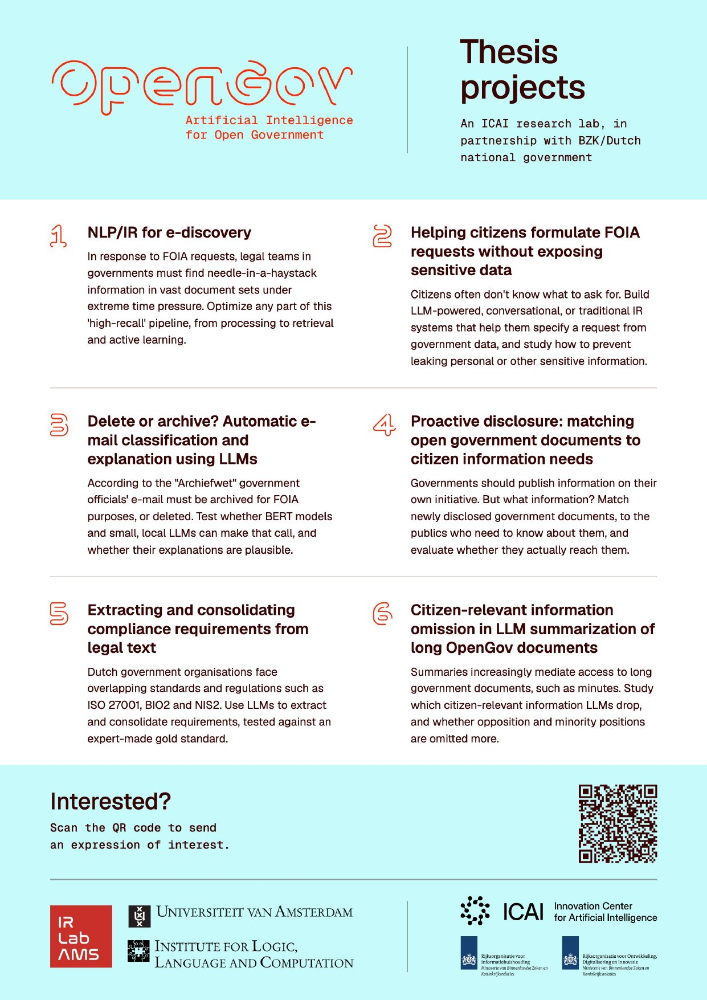

---
date:
  created: 2026-10-16
categories:
  - students
authors:
  - dgraus
title: New thesis projects at the OpenGov Lab
description: The OpenGov Lab has six new thesis projects on AI for open government, from e-discovery for FOIA requests to LLM summarization of government documents. Download the flyer and let us know if you are interested!
image: thesis-projects-flyer.jpg
---

The OpenGov Lab has six new thesis projects for (Master) students who want to work on AI for open government. The projects range from e-discovery for FOIA requests to how LLM summaries of government documents leave out what matters to citizens. [**Download the flyer (PDF)**](/flyers/thesis-projects.pdf).

<!-- more -->

1. **NLP/IR for e-discovery**: optimize any part of the high-recall pipeline that government legal teams use to find relevant documents for FOIA requests.
2. **Helping citizens formulate FOIA requests without exposing sensitive data**: build systems that help citizens specify what they are looking for, without leaking personal or other sensitive information.
3. **Delete or archive?**: test whether BERT models and small, local LLMs can decide which e-mails must be archived under the Archiefwet, and whether their explanations are plausible.
4. **Proactive disclosure**: match newly published government documents to the citizens who need to know about them.
5. **Extracting and consolidating compliance requirements from legal text**: use LLMs to extract and consolidate requirements from overlapping standards such as ISO 27001, BIO2 and NIS2.
6. **Citizen-relevant information omission in LLM summarization**: study which information LLM summaries of long government documents drop, and whether opposition and minority positions are left out more often.

Interested? [**Send us an expression of interest**](https://docs.google.com/forms/d/e/1FAIpQLSf1NUCd7cg-wjTOMn5Lo8gX8onBPf8_oFlJhECgg2baKrTdyQ/viewform), or [contact](/contact) us with any questions!

[{ loading=lazy }](/flyers/thesis-projects.pdf)
