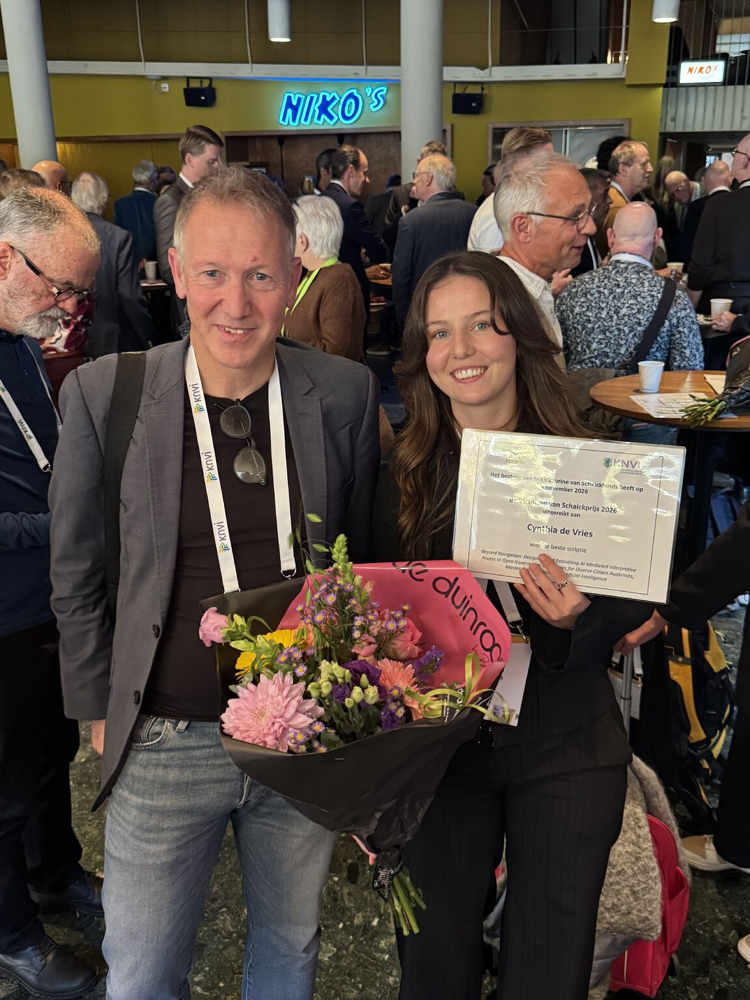

---
date:
  created: 2026-11-20
categories:
  - awards
authors:
  - dgraus
title: Cynthia de Vries Wins Victorine van Schaick Prize for Thesis on Making Woo Dossiers Understandable
description: Cynthia de Vries wins the Victorine van Schaick Prize 2026 for Best Master's Thesis for her OpenGov Lab thesis on Quick Guide, an AI layer that helps people understand Woo dossiers, written under the supervision of Jaap Kamps.
image: cynthia-knvi-2026.jpg
---

# Cynthia de Vries Wins Victorine van Schaick Prize for Thesis on Making Woo Dossiers Understandable

We're proud to share that **Cynthia de Vries** has won the **Victorine van Schaick Prize 2026** for Best Master's Thesis, awarded by the Victorine van Schaick Fund and the [KNVI](https://www.knvi.nl/) (Koninklijke Nederlandse Vereniging van Informatieprofessionals). Cynthia wrote her thesis for the [Cultural Data & AI](https://www.uva.nl/shared-content/programmas/en/masters/cultural-data-ai/cultural-data-and-artificial-intelligence.html) master's programme under the supervision of **Jaap Kamps** at the **ICAI OpenGov Lab**, and graduated *cum laude* earlier this year. The winners were announced at the KNVI Event on November 5 ([press release, in Dutch](https://www.knvi.nl/nieuwspagina/2026/11/12/winnaars-victorines-2026-bekend)).

{ loading=lazy }
/// caption
Cynthia de Vries receiving the Victorine van Schaick Prize 2026 at the KNVI Event, with her supervisor Jaap Kamps.
///

Her thesis, **"Beyond Navigation: Designing and Evaluating AI-Mediated Interpretive Access to Open Government Disclosures for Diverse Citizen Audiences,"** was praised by the jury as being of *"exceptional academic quality"*, pairing *"a solid theoretical framework with an elegant and socially relevant solution."* In the jury's words, Cynthia's thesis *"bridges advanced technology (AI) and the end user"* and *"improves the information position of citizens in a democratic society."*

<!-- more -->

Cynthia's thesis builds on **WOOLens**, a tool that makes Woo dossiers navigable, which she developed with fellow students and Jaap Kamps and which was presented at the [First AI & Open Government Workshop at ICAIL 2026](../20260505-three-papers-accepted-aiog2026/three-papers-accepted-aiog2026.md). Her thesis takes the next step: from helping people *navigate* government documents to helping them *understand* what's in them. She designed and evaluated **Quick Guide**, an AI-powered layer that gives an overview of an entire dossier, explains redactions in plain language, and makes dossiers accessible in English and Papiamentu besides Dutch.

In her user study, none of the participants understood the redactions in a dossier without Quick Guide, while all of them did with it. Read [Cynthia's own post](https://www.linkedin.com/feed/update/urn:li:activity:7525935585409286145/) for more on her findings.

## Two years in a row

This is the second year running that an OpenGov Lab thesis has received the prize, after [Barbora Wenzlová won in 2025](../20251117-barbora-wins-knvi-award-opengov-thesis/barbora-knvi-2025-algorithm-register-transparency.md) for her thesis on the Dutch Algorithm Register.

Congratulations, Cynthia, on a well-deserved award! 🏆
